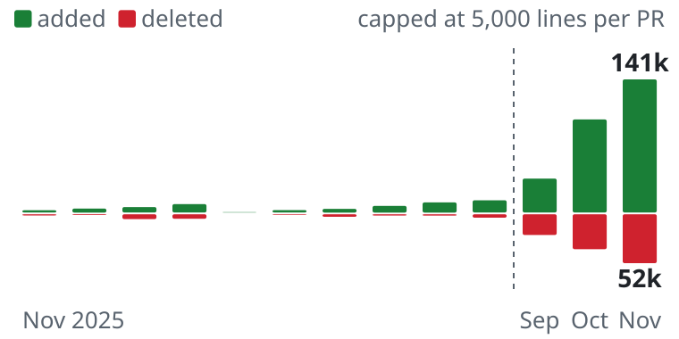

**I'm a senior software engineer with a team's output.** I work embedded in client teams: drop me into yours and I'll learn the stack and get things into production fast.

Agents have written all my code since January. In August I started building my own workflow and agent fleet around them, and I keep improving both. I run it from [T3 Code](https://github.com/pingdotgg/t3code) on my PC or my phone. I write the spec, agents build it in parallel, and nothing gets merged until it's tested, reviewed (up to three times) and green on CI. That's the jump you see below.

<picture><source media="(prefers-color-scheme: dark)" srcset="assets/prs-dark.svg"></picture>

Since August: **652** PRs in **25+** repos. Half are under **216** lines and 90% are under **2,915**. **23%** of the lines I change are tests. [Here's a typical one.](https://github.com/snnbotchway/faultline/pull/22)

### My best work is private

[**590** of those 652 PRs](https://github.com/snnbotchway/snnbotchway/blob/main/stats/README.md) went to 15+ private projects for my employer and clients. All of it runs in production, and I can't link any of it. Think internal systems a business runs on every day, payment and messaging tools, and DeFi backends. Email me at [solomonbotchway7@gmail.com](mailto:solomonbotchway7@gmail.com) and I'll walk you through it, as far as my NDAs allow.

### What I can show

- [faultline](https://github.com/snnbotchway/faultline): a better frontend for self-hosted GlitchTip. Issues, uptime, performance, logs, releases, alerts, the lot. I built it for the error tracking we run at work.
- [django-entra-staff](https://github.com/snnbotchway/django-entra-staff): staff sign-in for Django apps. Microsoft Entra, passwords that need an authenticator code, and access by group. Our internal apps at work sign in with it.
- [Scrimly](https://github.com/snnbotchway/scrimly-case-study): a tournament platform for mobile esports that I built on my own and ran in production. Teams uploaded their match screenshots and AI read the scores straight into the leaderboard.

### Merged upstream

- OpenZeppelin relayer: [Redis TLS support](https://github.com/OpenZeppelin/openzeppelin-relayer/pull/674) and [unique IDs for Redis workers](https://github.com/OpenZeppelin/openzeppelin-relayer/pull/892), plus [newer Node support](https://github.com/OpenZeppelin/openzeppelin-relayer-sdk/pull/168) in the SDK. I needed all three for client work in production, so I added them upstream.
- t3code: kept the preview browser on the latest Chrome security fixes ([156](https://github.com/pingdotgg/t3code/pull/27822), [157](https://github.com/pingdotgg/t3code/pull/30820)).
- djoser: [rewrote the activation email](https://github.com/sunscrapers/djoser/pull/731).

Lines shipped and PR sizes

<picture><source media="(prefers-color-scheme: dark)" srcset="assets/lines-dark.svg"></picture>

Measure | Since August
--- | --:
[Lines shipped](https://github.com/snnbotchway/snnbotchway/blob/main/stats/README.md#lines-shipped), uncapped | 1.0M
PRs of 1,000 lines or more | 143
PRs of 5,000 lines or more | 36

Hiring? Email me at [solomonbotchway7@gmail.com](mailto:solomonbotchway7@gmail.com).

Updated 27 Nov 2026 · <a href="https://github.com/snnbotchway/snnbotchway/blob/main/stats/README.md">How these numbers are counted</a>
